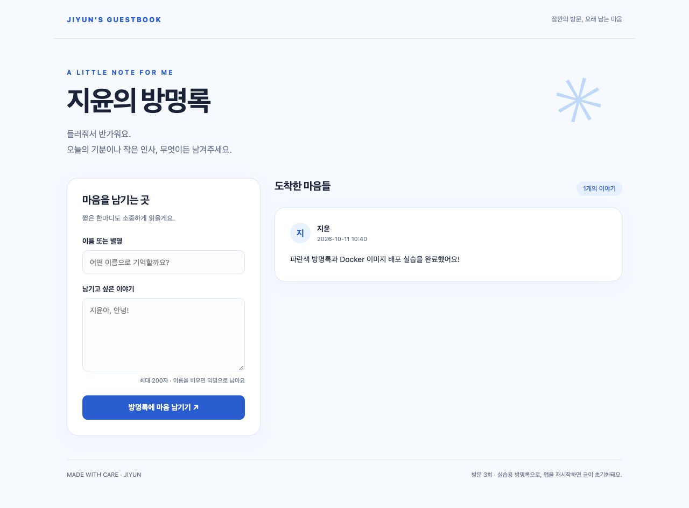
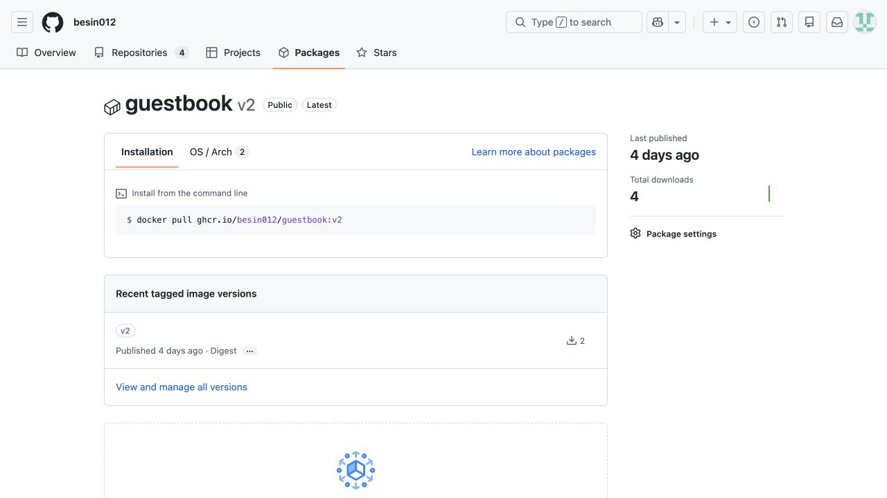
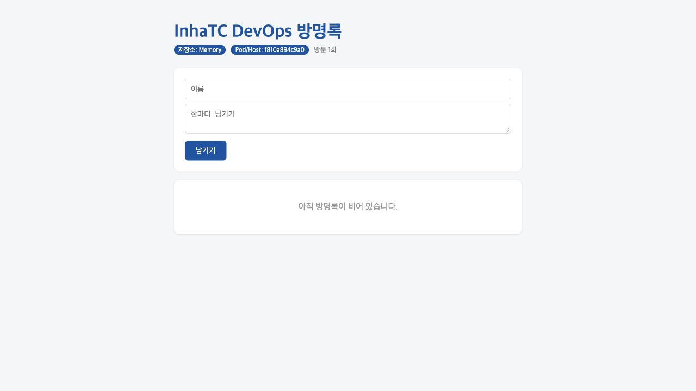
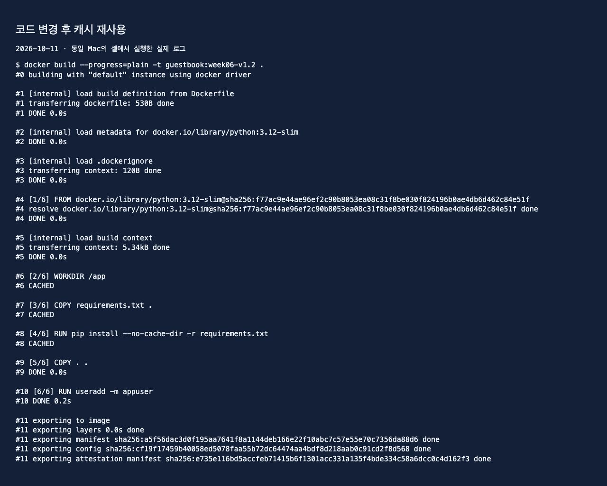

# 6주차: Dockerfile과 방명록 배포

실습일: 2026-10-11. 교안 `DevOps_06_도커파일.pdf`의 실습 순서로 동일 Mac의 셸에서 실행했다.
macOS Terminal 앱 GUI는 도구에서 차단되어 셸 실행 결과를 `logs/`에 기록했다.

## 내 이미지와 방명록

- 이미지: `ghcr.io/besin012/guestbook:v2`
- 패키지: https://github.com/users/besin012/packages/container/package/guestbook
- 10월 7일 업로드 완료, 10월 11일 사용자 승인으로 Public 변경 및 인증 없는 pull/run 검증 완료.
- 기본 제목: 지윤의 방명록. 테마: `#0B5ED7`. 문구 및 편지 형태의 레이아웃도 수정.
- 기존 방명록 소스는 `week06/guestbook/`에 유지했다. 교안은 저장소 루트의 `guestbook/` 하나를 다음 주에도 계속 수정하도록 권장하지만, 이번에는 사용자가 요청한 기존 구조를 보존했다. 다음 주에 새 복사본을 만들지 말고 같은 소스를 이어서 사용한다.
- 기존 컨테이너 `jiyun-guestbook`: http://localhost:8081




## 교안 순서와 실제 결과

| 교안 페이지 | 실습 | 결과와 기록 |
|---|---|---|
| 6 | latest 생략 시 실패 | latest manifest 없음. `logs/06-latest-tag.txt` |
| 17–18 | pull/run, 환경변수 변경 | GHCR 예제의 v1 manifest 참조가 깨져 실패. 교안 7쪽의 동일 앱 Docker Hub 예제로 대체하여 성공. `17-fallback-*.txt`, `18-*.txt` |
| 19–22 | 파일, 로컬 실행, Dockerfile, 기본값 | 기존 템플릿 사용. Mac Python에는 Flask가 없어 로컬 실행은 예상대로 실패. Docker 내부 실행은 성공. |
| 23–24 | build/run, 글 등록 | `guestbook:week06-v1` 빌드 및 테스트 글 등록 성공. `23-build-v1.txt`, `24-post.txt` |
| 25–27 | 캐시 비교, 나쁜 이미지 정리 | 수정 없이 재빌드 CACHED. HTML 변경 시 pip CACHED. 나쁜 순서는 코드 변경 후 pip 재설치. 원본 디자인 보존을 위해 임시 컨텍스트에서 비교. |
| 29–31 | 로그인/태그/푸시 및 공개 | 10월 7일 GHCR 푸시 완료. 10월 11일 Public 전환. 토큰은 기록하지 않음. |
| 32 | 이미지 교환 | 친구 주소 미제공으로 교안의 Docker Hub 공개 예제로 대체. 실제 친구 이미지 실습으로 주장하지 않음. |
| 34 | 아키텍처 | 현재 게시 이미지의 실제 실행 플랫폼은 linux/arm64. index의 unknown 항목은 attestation이며 amd64 지원을 뜻하지 않는다. 멀티 플랫폼 푸시는 이번 실행에 포함하지 않음. |
| 35–36 | Docker Hub 업로드 | 다른 레지스트리 선택 예제. 과제는 한 곳 업로드만 요구하므로 GHCR 사용. |
| 38 | 내 이미지 다시 pull/run/exec | Private 상태에서는 unauthorized였고 Public 전환 뒤 성공. `38-public-*.txt` |
| 39 | 내 v2 + 실행 환경변수 | 원본 파란색은 유지. 별도 실습 컨테이너에서 `#C6A15B` 주입 성공. |
| 40–42 | 기존 이미지에 ENV 굽기, -e 비교 | `Dockerfile.custom`으로 `#7C9A82`를 굽고 실행 시 `#16a34a`로 덮어씀. |
| 43 | README, commit/push/tag | 본 문서 및 실습 결과를 main에 커밋하고 week06 태그로 기록. |
| 46 | 멀티스테이지 크기 비교 | fat 227MB/콘텐츠49.2MB, slim 224MB/콘텐츠48.2MB. `46-size.txt` |
| 47 | 재시작과 메모리 | 등록 전후 count 1 → restart → count 0. `47-*.txt` |

기존 8081 방명록과 충돌하지 않도록 실습용 포트는 18080–18086, 19090을 사용했다.



## Dockerfile 각 줄 설명

| 명령 | 내 설명 |
|---|---|
| `FROM python:3.12-slim` | Python 3.12 실행 환경을 기반으로 이미지 생성 |
| `WORKDIR /app` | 이후 작업의 기준 경로를 /app으로 설정 |
| `COPY requirements.txt .` | 의존성 목록만 먼저 복사 |
| `RUN pip install --no-cache-dir -r requirements.txt` | 빌드 때 Flask와 Redis 라이브러리 설치. --no-cache-dir은 pip 다운로드 캐시 옵션이며 Docker 레이어 캐시와 별개 |
| `COPY . .` | 앱 코드와 템플릿 복사. COPY 원본은 빌드 컨텍스트 기준 |
| `RUN useradd -m appuser` | 실행용 일반 사용자 생성 |
| `USER appuser` | 이후 컨테이너를 root 대신 일반 사용자로 실행 |
| `ENV APP_TITLE=... THEME_COLOR=...` | 제목과 색상의 이미지 기본값 설정 |
| `EXPOSE 5000` | 앱 사용 포트를 문서화. 실제 접속에는 -p 필요 |
| `CMD ["python", "app.py"]` | 컨테이너가 시작할 때 Flask 앱 실행 |

## 캐시 결과

좋은 순서: `COPY requirements.txt` → `RUN pip install` → `COPY . .`.
의존성 목록이 그대로이면 앱 코드만 변경해도 설치 레이어는 재사용된다.
캐시가 무효화된 단계 이후 단계는 다시 처리한다. 자주 바뀌는 코드 복사는 뒤에 배치한다.

실제 비교: `logs/25-code-change.txt`의 requirements와 pip 단계는 CACHED, COPY . .은 새로 실행.
`logs/26-bad-after.txt`에서는 COPY . . 다음 pip install이 새로 실행됐다.



## 설정 우선순위

`app.py 기본값 < Dockerfile ENV < docker run -e`.
코드나 이미지 기본값을 바꾸려면 재빌드가 필요하지만, -e는 같은 이미지로 컨테이너만 다시 실행하면 된다.
셸의 export 값은 자동으로 컨테이너에 전달되지 않는다. `-e 변수명` 또는 `-e 변수명=값`으로 전달한다.

## 기록 확인과 재실행

```bash
cd ~/Desktop/2학년2학기/DevOps/devops
cat week06/logs/23-build-v1.txt
cat week06/logs/25-code-change.txt
cat week06/logs/38-public-pull.txt
```

`scripts/run_lab.py`와 `continue_lab.py`는 이번 실습에 사용한 실행 스크립트이다.
동일한 이름의 실습 컨테이너가 존재하면 run이 실패하므로, 재실행 전 자신의 실습 컨테이너 상태를 확인한다.
기존 `jiyun-guestbook`은 삭제하지 않는다.
