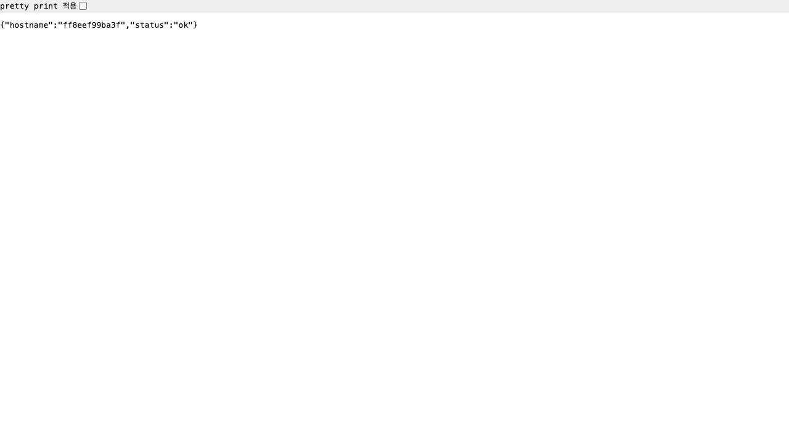

# 7주차 - Docker Compose

방명록에 Redis를 연결하고 nginx를 통해 웹 컨테이너 3개로 요청을 나눴다.
소스는 [week06/guestbook](../week06/guestbook/)을 이어서 사용했다.

## 1. docker compose ps 결과

```bash
cd week06/guestbook
docker compose ps
```

저장소 루트에서 이동해 확인했다. 아래는 2026년 10월 21일 실행 결과다.

```text
NAME                  IMAGE             COMMAND                  SERVICE   CREATED      STATUS                PORTS
week07-lab1-nginx-1   nginx:alpine      "/docker-entrypoint.…"   nginx     9 days ago   Up 9 days             127.0.0.1:8080->80/tcp
week07-lab1-redis-1   redis:7-alpine    "docker-entrypoint.s…"   redis     9 days ago   Up 9 days (healthy)   6379/tcp
week07-lab1-web-1     week07-lab1-web   "python app.py"          web       9 days ago   Up 9 days (healthy)   5000/tcp
week07-lab1-web-2     week07-lab1-web   "python app.py"          web       9 days ago   Up 9 days (healthy)   5000/tcp
week07-lab1-web-3     week07-lab1-web   "python app.py"          web       9 days ago   Up 9 days (healthy)   5000/tcp
```

nginx 1개, Redis 1개, web 3개가 실행 중이다.
Redis와 web은 모두 healthy였다. Redis가 준비된 뒤 web이 시작되도록 healthcheck와 depends_on을 설정했다.

[실행 결과 원문](logs/compose-ps-2026-10-21.txt)

## 2. scale 후 웹 컨테이너 확인

```bash
docker compose up -d --scale web=3
```

처음에는 web마다 8080 포트를 사용해서 충돌했다.
nginx만 8080을 사용하고 web은 내부 5000 포트를 사용하도록 바꿨다.

```text
브라우저 :8080 → nginx → web 3개 → Redis 1개
```

http://localhost:8080/healthz 를 새로고침하면서 확인했다.
요청마다 아래처럼 hostname이 달라져 서로 다른 웹 컨테이너가 응답하는 것을 확인했다.
메인 화면은 hostname을 표시하지 않아 상태 확인 주소로 캡처했다.

### 응답 1: `ff8eef99ba3f`



### 응답 2: `380696d68b1e`


### 응답 3: `2a151a9c02b7`


세 웹은 같은 Redis를 사용하므로 어느 웹이 응답해도 글 목록은 같았다.
[반복 요청 기록](logs/self-study-hostnames.json)

## 3. down과 down -v 차이

테스트 글 3개를 등록하고 비교했다. 아래 결과는 10월 12일 실습 기록이다.

| 실행 순서 | 볼륨 | 글 개수 |
|---|---|---|
| 글 등록 → restart web | 유지 | 3개 유지 |
| down → up -d | 유지 | 3개 유지 |
| down -v → up -d | 삭제 후 새로 생성 | 0개 |

`down`은 컨테이너와 네트워크만 지우고 볼륨은 남긴다.
다시 실행하면 기존 Redis 데이터를 읽어서 글이 유지됐다.
`down -v`는 볼륨까지 지워서 다시 실행했을 때 글이 사라졌다.
데이터를 유지해야 할 때는 `-v`를 붙이지 않아야 한다.

[down 후 결과](logs/12-after-down-up.json) / [down -v 후 결과](logs/15-after-down-v-up.json)

## 4. .env를 Git에 올리지 않는 이유

.env에는 Redis 비밀번호 같은 실제 설정값이 들어 있다.
공개 저장소에 올리면 다른 사람도 볼 수 있고, 나중에 파일에서 지워도 Git 이력에 남을 수 있다.

- compose.yaml: 실제 비밀번호 대신 `${REDIS_PASSWORD}`를 사용한다.
- .env: 내 컴퓨터에만 두고 .gitignore에 추가했다.
- .env.example: 비밀번호 대신 작성 양식만 공유한다.
- .dockerignore: .env가 이미지에 복사되지 않도록 제외한다.

.gitignore는 암호화가 아니라 Git에서 제외하는 설정이다.
[.env 제외 확인](logs/lab3-02-env-ignored.txt)

## 추가 메모

- 호스트에서는 Redis 6379 포트에 접속할 수 없지만 web 안에서는 redis라는 서비스 이름으로 연결됐다.
- web 하나를 직접 중지해도 자동으로 다시 켜지지 않았다. `docker compose up -d --scale web=3`으로 복구했다.
- `docker compose config -q`로 설정 검사를 했다. 비밀번호가 비어 있으면 오류가 났다.
- watch 설정은 저장했지만 자동 재빌드는 성공 확인을 못 했다. 문구 변경은 수동 재빌드로 반영했다.

나머지 실행 결과는 [logs](logs/)에 있다.
