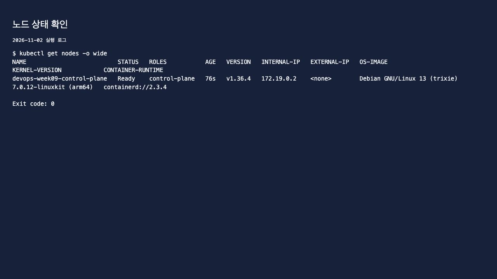
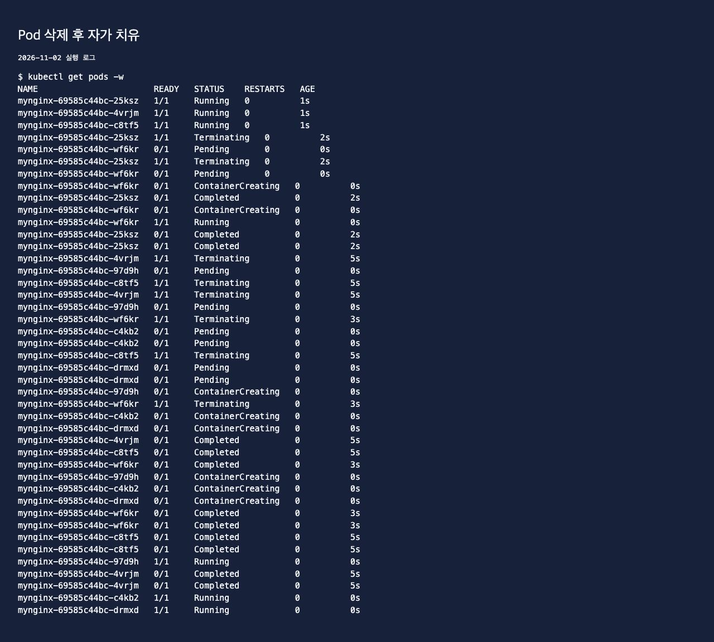
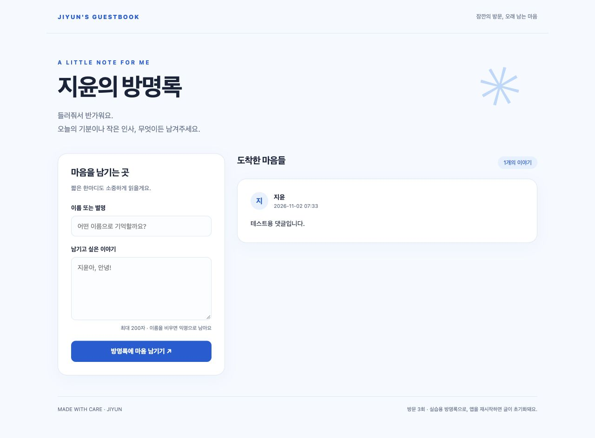
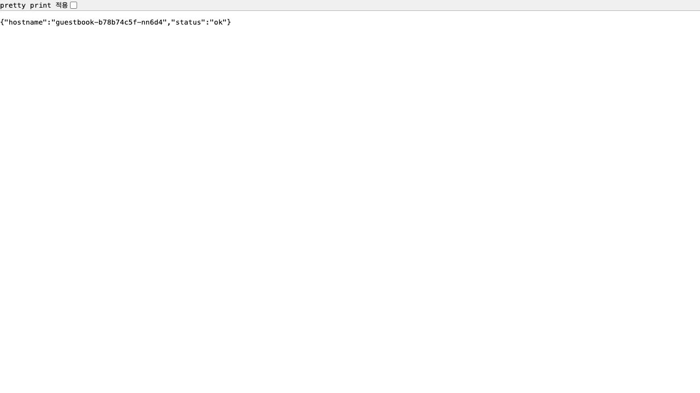

# 9주차 - Kubernetes

kind로 클러스터를 만들고 Pod, Deployment, 자가 치유를 확인했다.
교안 파일 이름은 08이지만 수업 주차에 맞춰 week09에 기록했다.
실습일: 2026년 11월 2일.

## 1. 클러스터 확인

Mac에서 kind v0.33.0을 사용했다. 클러스터 이름은 devops-week09이고 Kubernetes 버전은 v1.36.4다.
기존 설정과 섞이지 않도록 별도 kubeconfig를 사용했다.

```bash
kubectl config current-context
kubectl get nodes -o wide
kubectl get pods -A
```

노드가 Ready인 것을 확인했다.



## 2. Pod와 Deployment 비교

```bash
kubectl run mynginx --image=nginx:alpine
kubectl get pods
kubectl describe pod mynginx
kubectl logs mynginx
kubectl exec mynginx -- sh
```

Pod를 실행하고 로그와 내부 파일을 확인했다. 단독으로 만든 Pod는 삭제하니 다시 생기지 않았다.

```bash
kubectl delete pod mynginx
kubectl create deployment mynginx --image=nginx:alpine --replicas=3
kubectl get pods -w
```

Deployment로 만든 Pod는 하나를 지우자 새 이름의 Pod가 생겨 3개로 돌아왔다.
`mynginx-69585c44bc-25ksz`를 지운 뒤 `mynginx-69585c44bc-wf6kr`가 만들어졌다.
모두 삭제했을 때도 다시 3개가 생성됐다.



Deployment → ReplicaSet → Pod 순서로 관리된다. 개수를 유지하는 것은 ReplicaSet이다.
`--replicas=5`로 늘리고 `--replicas=2`로 줄이는 것도 확인했다.

## 3. 내 방명록 배포

```bash
kubectl create deployment guestbook --image=ghcr.io/besin012/guestbook:v2
kubectl logs -l app=guestbook
kubectl port-forward deployment/guestbook 18090:5000
```

기존 방명록 이미지 v2를 사용했다. 8080은 Compose에서 사용 중이라 18090으로 연결했다.
http://localhost:18090 에서 화면과 테스트 댓글이 보였다.



메인 화면에는 hostname이 없어 /healthz로 Pod 이름을 확인했다.



방명록 Pod를 지운 뒤 새 Pod가 생겼지만, 메모리에 저장한 글은 사라졌다.
기존 port-forward도 끊겨 다시 실행해야 했다. Pod 복구와 데이터·접속 복구는 다르다는 것을 확인했다.
캡처 후 확인할 수 있도록 방명록 Deployment와 연결은 실행 상태로 두었다.

## 선언형 정리

원하는 상태를 정해두면 현재 상태와 비교해 맞춰주는 방식이다.
에어컨에 온도를 정해두면 그 온도를 유지하는 것처럼 replicas를 3으로 정하면 Pod 3개를 유지한다.

## 막힌 부분

- kind로 이미지를 옮길 때 content digest not found가 나왔다. linux/arm64만 docker image save로 내보내고 kind load image-archive로 불러와 해결했다.
- port-forward는 연결한 Pod가 지워지면 끊겼다. 새 Pod가 준비된 뒤 명령을 다시 실행했다.

캡처의 노드·자가 치유 화면은 실제 셸 로그를 브라우저에 표시한 것이다.
나머지 명령어와 결과는 [logs](logs/)에 저장했다. kubeconfig와 인증 정보는 저장소에 올리지 않았다.
