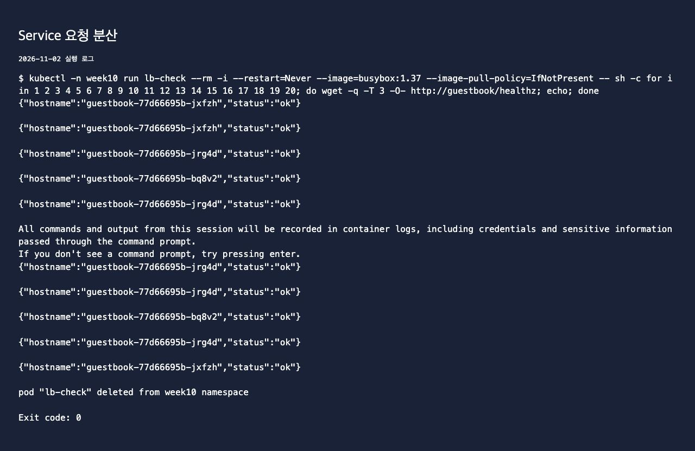
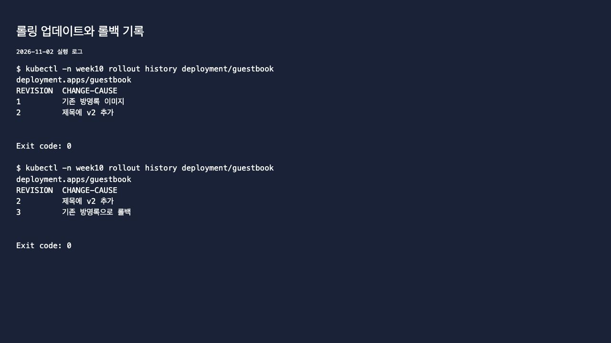
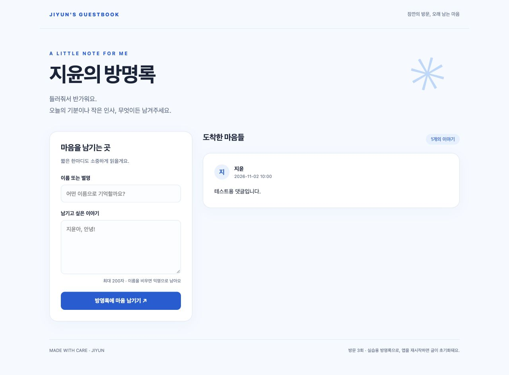
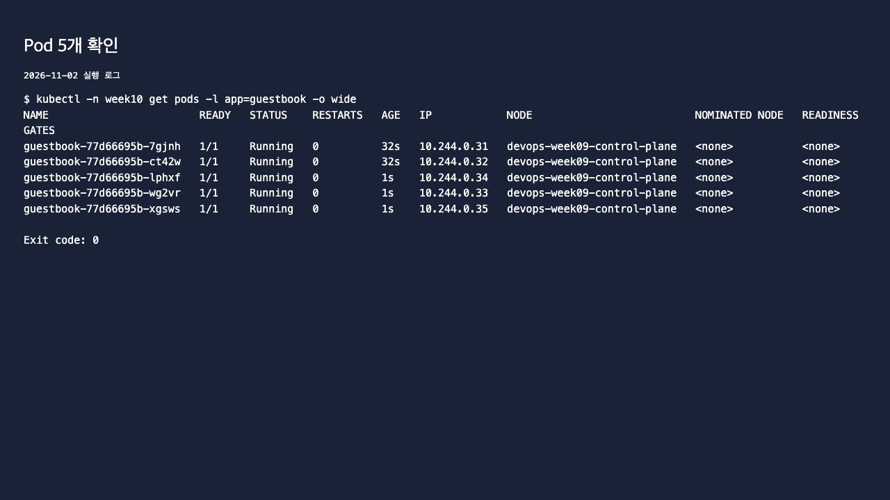

# 10주차 - Kubernetes 배포와 Service

Deployment와 Service를 YAML로 작성하고, 개수 변경과 롤링 업데이트·롤백을 확인했다.
기존 kind 클러스터에서 week10 네임스페이스를 따로 사용했다.
실습일: 2026년 11월 2일.

## 1. YAML 배포

파일은 [guestbook/k8s](../week06/guestbook/k8s/)에 모았다.
저장소 루트에서 실행한다. kubectl은 기존 kind 클러스터 설정을 사용한다.

```bash
kubectl apply -f week06/guestbook/k8s/namespace.yaml
kubectl -n week10 apply -f week06/guestbook/k8s/deployment.yaml --dry-run=server
kubectl -n week10 apply -f week06/guestbook/k8s/deployment.yaml
kubectl -n week10 apply -f week06/guestbook/k8s/service.yaml
kubectl -n week10 get deploy,rs,pods,svc
```

처음 replicas를 2로 배포하고, 같은 파일을 다시 적용하니 unchanged가 나왔다.
파일에서 3으로 바꾸면 3개가 되었고 다시 2로 돌리면 줄어들었다.
명령으로 4개로 늘린 뒤 replicas가 2인 파일을 apply하면 다시 2개가 됐다.
Pod 하나를 지워도 새 Pod가 생겨 설정한 개수를 유지했다.

Deployment가 ReplicaSet을 만들고, ReplicaSet이 Pod 개수를 맞춘다.
Deployment의 matchLabels와 Pod labels, Service selector는 모두 app: guestbook으로 맞췄다.

## 2. Service와 요청 분산

서비스는 NodePort로 설정했다. nodePort는 30080, port는 80, targetPort는 5000이다.
Pod IP가 바뀌어도 Service가 레이블로 연결 대상을 찾는다.

웹 4개를 띄운 뒤 클러스터 안의 busybox Pod에서 http://guestbook/healthz 에 요청했다.
기록에 남은 10개 응답 중 서로 다른 hostname 3개를 확인했다.



kind에서는 브라우저 확인에 아래 명령을 사용했다. port-forward는 Pod 하나로 연결하므로 분산 확인은 위 내부 요청으로 했다.

```bash
kubectl -n week10 port-forward svc/guestbook 18093:80
```

접속 주소: http://localhost:18093

## 3. 롤링 업데이트와 롤백

기존 이미지 ghcr.io/besin012/guestbook:v2를 시작 버전으로 사용했다.
제목에 v2를 붙인 실습용 이미지는 [Dockerfile.v2](Dockerfile.v2)로 만들었다.
새 태그는 guestbook:week10-v2이며 레지스트리에 푸시하지 않고 kind에 직접 불러왔다.
교안의 v1 → v2와 같은 두 버전 비교이며, 기존 GHCR v2 태그는 덮어쓰지 않았다.

```bash
kubectl -n week10 set image deployment/guestbook web=guestbook:week10-v2
kubectl -n week10 rollout status deployment/guestbook
kubectl -n week10 rollout history deployment/guestbook
kubectl -n week10 rollout undo deployment/guestbook
kubectl -n week10 rollout status deployment/guestbook
```

새 ReplicaSet으로 Pod가 순서대로 교체됐고 제목도 '지윤의 방명록 v2'로 바뀌었다.
업데이트 중 모은 HTTP 확인 결과는 성공 31회, 실패 0회였다. 이번 관찰 결과이며 항상 무중단을 보장한다는 뜻은 아니다.
롤백 후 원래 제목으로 돌아왔고 revision은 3으로 증가했다.
annotate로 변경 이유도 기록했다.



명령으로 이미지만 바꾸면 YAML의 image는 그대로 남는다. 계속 사용할 버전은 파일에도 맞춰 두어야 한다.
최종 파일과 실행 상태는 모두 원래 이미지로 맞췄다.



## 4. 혼자 해보기

최종 replicas를 5로 늘리고 YAML에도 5를 저장했다.
Pod 하나를 --force --grace-period=0으로 삭제한 뒤 새 Pod가 생겨 다시 5개가 되는 것도 확인했다.
다시 apply해도 2개로 줄지 않도록 파일과 실제 상태를 맞췄다.



Pod 삭제 후 복구, Service를 통한 서로 다른 hostname, 롤링 업데이트 이력과 롤백 결과는 [logs](logs/)에 저장했다.
방명록은 아직 메모리 모드여서 Pod마다 글이 다를 수 있다. Service가 데이터를 공유해주는 것은 아니다.
